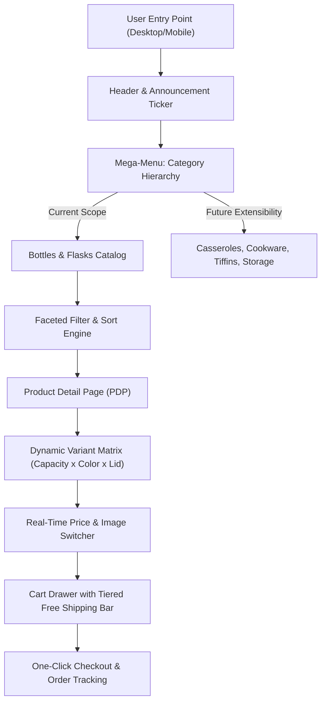
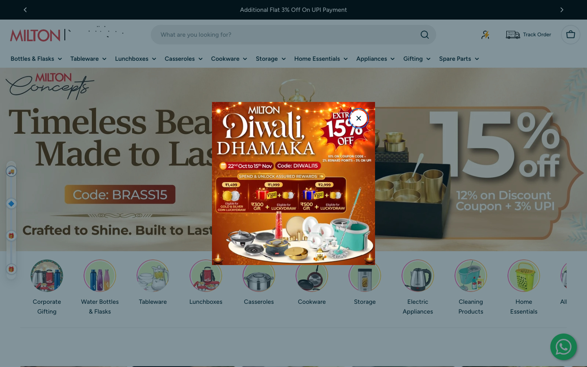
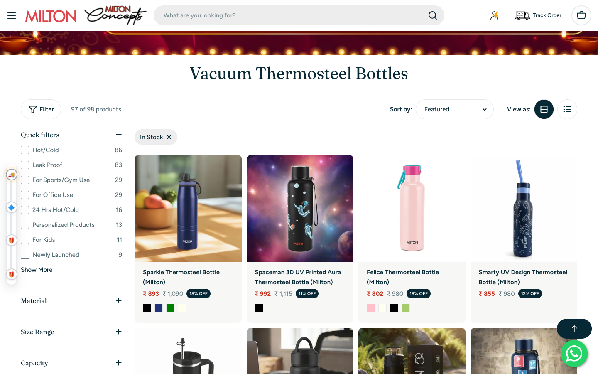
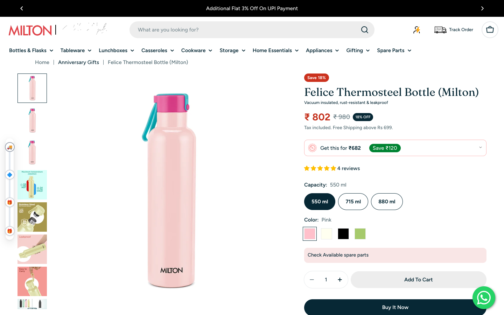
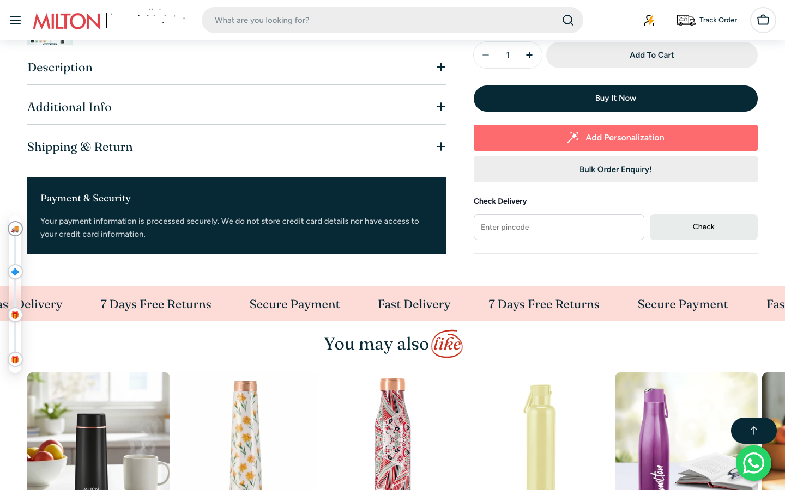
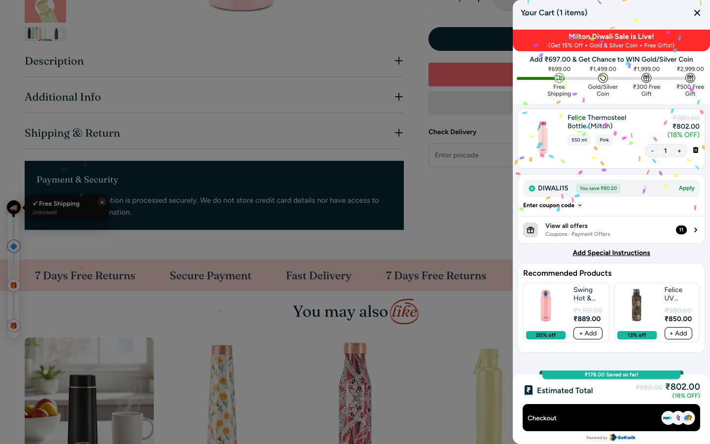
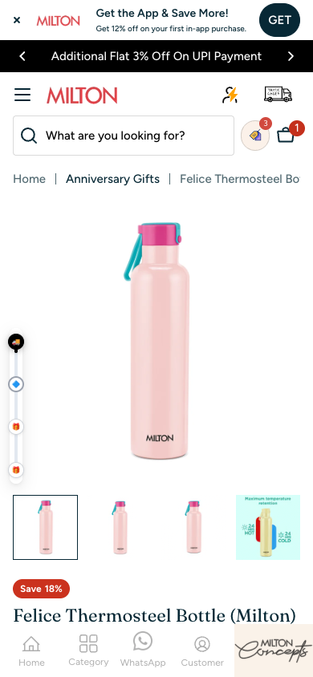
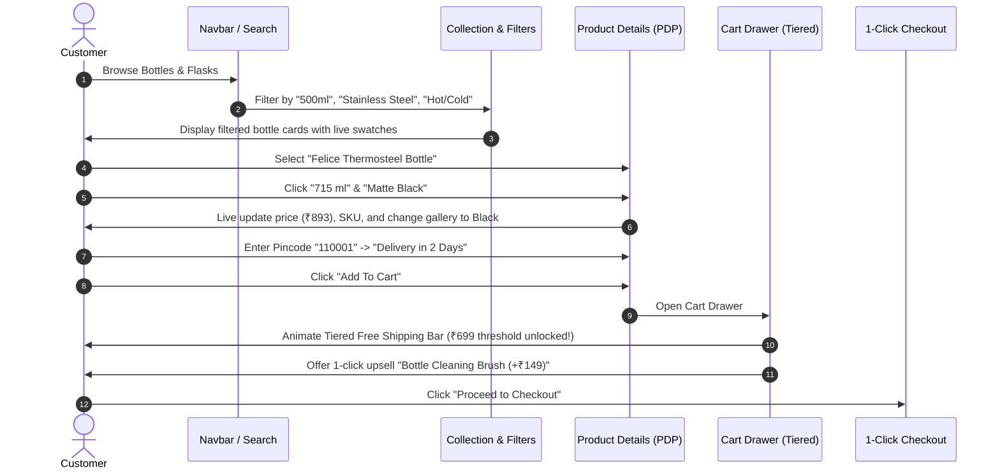
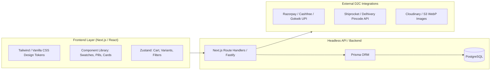

# Milton E-Commerce Architecture & Implementation Plan

> **Reference Live Target:** [https://www.milton.in/](https://www.milton.in/)  
> **Workspace:** `/Users/ashishtayal/All Project/ecommerce_milton`  
> **Screenshots Directory:** `./screenshots/`  
> **Design Philosophy:** Premium D2C Warm Minimalism, Tactile Craftsmanship, High Trust.  
> **Strict Constraint:** Zero AI neon, zero cyberpunk tropes, zero aggressive popup clutter.

---

## 1. Executive Summary & Reverse-Engineering Findings

Through static analysis, DOM decompilation, and automated browser observation of **Milton.in**, we reverse-engineered the entire e-commerce user journey and technical stack. Milton operates on **Shopify Plus** coupled with third-party headless integrations (**Gokwik** one-click checkout, **GA4**, **Klaviyo**, and custom Liquid sections).



### Key Technical & UX Discoveries

| Feature / Subsystem | Milton.in Implementation (Observed) | Our Enhanced Architecture (To Build) |
| :--- | :--- | :--- |
| **Tech Foundation** | Shopify Liquid Theme with heavy DOM rendering | Modern Next.js (App Router) / React + Vite with SSR/SSG for lightning page speed |
| **Visual Aesthetic** | Classic Indian D2C: `#d1493f` (Milton Red), `#072835` (Navy), Figtree + Fraunces typography | Clean, warm-minimalist luxury (Apple / Yeti style cleanliness meets Milton's heritage trust) |
| **Variant Handling** | Shopify Options (`option1`, `option2`) triggering Liquid page reloads or AJAX | Zero-latency client-state variant matrix with pre-cached image swapping and inventory sync |
| **Category Scope** | 300+ collections across 10 main categories | Scalable **Option-Dimension Schema**: Bottles first, then seamless plug-and-play for Cookware, Tiffins, etc. |
| **Cart Experience** | Slide-over drawer with tiered free-gift gamification bar | High-performance spring-animated slide drawer with real-time gift threshold calculations |
| **Checkout Flow** | Gokwik one-click checkout modal | Streamlined Indian D2C checkout with UPI, Cards, NetBanking, COD verification, and Pincode ETA |

---

## 2. Visual Evidence & Screen Reference Index

All high-resolution reference screenshots were captured from live Milton sessions and saved directly to `./screenshots/` in this repository for inspection:

### Screen 1: Top Navigation, Header & Homepage Hero
- **File:** [./screenshots/01_homepage_hero_nav.png](./screenshots/01_homepage_hero_nav.png)
- **Preview:**

- **Observed Elements:**
  - High-contrast black announcement ticker: `"Additional Flat 3% Off On UPI Payment"`.
  - Brand header with iconic Milton crimson logo (`#d1493f`).
  - Centered search pill with placeholder `"What are you looking for?"`.
  - Right utilities: VIP Reward icon, Track Order button with truck glyph, Cart icon with live counter badge.
  - Circular category quick-links: Water Bottles & Flasks, Tableware, Lunchboxes, Casseroles, Cookware, Storage, Electric Appliances, Cleaning Products.

---

### Screen 2: Bottle Category Collection Page & Faceted Filters
- **File:** [./screenshots/03_bottles_collection_desktop.png](./screenshots/03_bottles_collection_desktop.png)
- **Preview:**

- **Observed Elements:**
  - Collection title in elegant serif font: `"Vacuum Thermosteel Bottles"`.
  - Active filter chips: `In Stock [x]`, product counter (`97 of 98 products`), and Sort By dropdown (`Featured`, `Price: Low to High`, `Newest`).
  - Left Filter Sidebar: Quick filters (Hot/Cold, Leak Proof, Sports/Gym, Office Use, 24 Hrs Hot/Cold, Kids), Material (Stainless Steel, Copper, Glass, Plastic), Size Range, and Capacity.
  - Product Cards: Rounded border container (`#f7f7f5` background), title, pricing (Selling price in crimson, strikethrough MRP, dark navy discount badge e.g. `18% OFF`), and interactive color swatches.

---

### Screen 3: Product Detail Page (PDP) & Multi-Variant Selectors
- **File:** [./screenshots/04_bottle_pdp_desktop.png](./screenshots/04_bottle_pdp_desktop.png)
- **Preview:**

- **Observed Elements:**
  - Left thumbnail stack + large hero photo with clean drop-shadow.
  - Breadcrumbs: `Home | Anniversary Gifts | Felice Thermosteel Bottle (Milton)`.
  - Badge: `Save 18%` in signature crimson pill.
  - Heading: `Felice Thermosteel Bottle (Milton)` + Subtitle: `"Vacuum insulated, rust-resistant & leakproof"`.
  - Price Block: `₹ 802` in vermilion bold, strikethrough `₹ 980`, navy `18% OFF` badge, and shipping prompt `"Tax included. Free Shipping above Rs 699."`.
  - Special Offer Pill: `"Get this for ₹682 | Save ₹120 [dropdown]"`.
  - Star rating with link to customer reviews (`⭐⭐⭐⭐⭐ 4 reviews`).
  - **Variant Selector 1 (Capacity):** Pill buttons `[ 550 ml ]` (Active navy `#072835`), `[ 715 ml ]`, `[ 880 ml ]`.
  - **Variant Selector 2 (Color):** Color swatches for Pink, Ivory, Black, Olive Green with active border indicator.
  - Spare Parts Cross-Sell: `"Check Available spare parts"`.
  - Stepper & Buttons: `[ - 1 + ]` pill stepper, `Add To Cart` button, and full-width `Buy It Now` primary CTA.

---

### Screen 4: PDP Specifications, Pincode Checker & Trust Strip
- **File:** [./screenshots/05_bottle_pdp_features_specs.png](./screenshots/05_bottle_pdp_features_specs.png)
- **Preview:**

- **Observed Elements:**
  - Technical accordions: `Description`, `Additional Info` (material grade SS 304, weight, dimensions, warranty), `Shipping & Return`.
  - High-trust security card: Navy box outlining encrypted payments.
  - Action buttons: `Add Personalization` (for custom name engraving) and `Bulk Order Enquiry!` (for corporate gifting).
  - Pincode Delivery Check widget: `Enter pincode` input with `Check` button delivering estimated delivery dates (e.g., 2-4 business days).
  - Horizontal value proposition ribbon: `Fast Delivery • 7 Days Free Returns • Secure Payment`.
  - Cross-sell section: `"You may also like"` related drinkware carousel.

---

### Screen 5: Cart Drawer with Free Shipping & Gamified Milestones
- **File:** [./screenshots/06_cart_drawer.png](./screenshots/06_cart_drawer.png)
- **Preview:**

- **Observed Elements:**
  - Slide-over right drawer with smooth backdrop blur.
  - Tiered Gamified Progress Bar:
    * `₹699.00` -> Free Shipping (Unlocked status)
    * `₹1,499.00` -> Gold/Silver Coin Lucky Draw
    * `₹1,999.00` -> ₹300 Free Gift
    * `₹2,999.00` -> ₹500 Free Gift
  - Dynamic milestone motivator: `"Add ₹697.00 & Get Chance to WIN Gold/Silver Coin"`.
  - Item details showing selected variant badges inline: `[ 550 ml ]` `[ Pink ]`.
  - One-click coupon block: `DIWALI15` (`Save ₹80.20`) with `[Apply]` button.
  - In-cart mini upsell recommendations with one-click `+ Add` button.
  - Total savings pill: `"₹178.00 Saved so far!"`.
  - Sticky checkout bar with accepted payment badges (UPI, GPay, Paytm, Cards).

---

### Screen 6: Mobile Responsive PDP & Bottom Sticky Bar
- **File:** [./screenshots/07_bottle_pdp_mobile.png](./screenshots/07_bottle_pdp_mobile.png)
- **Preview:**

- **Observed Elements:**
  - Mobile sticky bottom navigation bar: `Home`, `Category`, `WhatsApp`, `Customer`.
  - Swipeable image gallery carousel with horizontal thumbnail strip.
  - Native touch-friendly pill buttons for sizes and colors.

---

## 3. Scalable Category & Taxonomy Architecture

The initial product catalog focuses entirely on **Bottles & Flasks**, but the database and state engine are decoupled so that adding new product categories (Cookware, Lunchboxes, Casseroles, Storage) requires **zero structural code rewrites**.

### Category Taxonomy Tree

```
└── Categories
    ├── 1. Bottles & Drinkware (CURRENT PHASE)
    │   ├── Vacuum Thermosteel (Insulated Hot & Cold)
    │   ├── Single-Wall Stainless Steel
    │   ├── Copper Bottles
    │   ├── Glass Bottles & Infusers
    │   ├── PET & PP Fitness Bottles (BPA-Free)
    │   ├── Kids Sippers & Flasks
    │   └── Carafes & Jugs
    │
    ├── 2. Lunchboxes & Tiffins (FUTURE PHASE)
    │   ├── Electric Heated Tiffins
    │   ├── Insulated Steel Tiffins (2/3/4 Containers)
    │   ├── Kids Bento Boxes
    │   └── Executive Tiffin Bags
    │
    ├── 3. Casseroles & Hot Pots (FUTURE PHASE)
    │   ├── Double-Walled Thermal Casseroles
    │   ├── Roti Keepers & Gift Sets (Sets of 3)
    │   └── Buffet Serving Warmers
    │
    ├── 4. Cookware (FUTURE PHASE)
    │   ├── Triply Stainless Steel Kadhai & Fry Pans
    │   ├── Hard Anodized Pressure Cookers (2L, 3L, 5L)
    │   └── Cast Iron Skillets & Tawas
    │
    └── 5. Storage & Kitchen Organization (FUTURE PHASE)
        ├── Airtight Glass Jars & Canisters
        ├── Modular Spice Racks
        └── Dry Food Dispensers
```

---

## 4. Universal Multi-Variant Data Schema

Every product belongs to a category, and each category dictates which **Option Dimensions** are active.

### Attribute Mapping Per Category

| Category | Option 1 (Primary) | Option 2 (Secondary) | Option 3 (Tertiary) | Custom Add-on |
| :--- | :--- | :--- | :--- | :--- |
| **Bottles & Flasks** | **Capacity** (`500ml`, `750ml`, `1000ml`) | **Color / Finish** (`Pink`, `Matte Black`, `Cobalt`) | **Cap / Lid Type** (`Flip Lid`, `Sipper`, `Straw`) | Laser Name Engraving |
| **Lunchboxes** | **Container Count** (`2 Containers`, `3`, `4`) | **Jacket Type** (`Thermal Bag`, `Denim Bag`) | **Color** (`Grey`, `Navy`, `Wine`) | Cutlery Set Bundle |
| **Casseroles** | **Capacity / Set** (`1.5L`, `2.5L`, `Set of 3`) | **Exterior Finish** (`Floral Ivory`, `Brushed SS`) | **Handle Type** (`Side Grip`, `Top Twist`) | Gift Box Packaging |
| **Cookware** | **Diameter / Size** (`20 cm`, `24 cm`, `28 cm`) | **Base Type** (`Induction Bottom`, `Standard`) | **Lid** (`Glass Lid`, `Steel Lid`) | None |

### TypeScript / Prisma Product Schema

```typescript
// Core Product Model
export interface Product {
  id: string;
  slug: string;
  title: string;
  tagline: string;
  descriptionHtml: string;
  categoryId: string;
  subcategoryId?: string;
  basePrice: number;
  featuredImageUrl: string;
  galleryImages: {
    url: string;
    alt: string;
    variantOptionValue?: string; // Links image to specific color (e.g. "Pink")
  }[];
  
  // Category-driven option definitions
  options: ProductOption[];
  
  // Flattened variant combinations
  variants: ProductVariant[];
  
  // Technical Specifications (Accordion data)
  specifications: {
    material: string;          // e.g. "SS 304 Food Grade Stainless Steel"
    thermalRetention?: string; // e.g. "24 Hours Hot / 24 Hours Cold"
    leakProof: boolean;        // true
    warranty: string;          // e.g. "1 Year Manufacturer Warranty"
    countryOfOrigin: string;   // "India"
    dimensions?: string;       // "7.8 x 7.8 x 28.5 cm"
    weightGrams?: number;      // 360
  };
  
  // Marketing & Trust Badges
  badges: string[];            // ["Bestseller", "Save 18%", "ISI Certified"]
  ratingAverage: number;       // 4.8
  reviewCount: number;         // 124
  personalizationAvailable: boolean; // Custom laser engraving support
}

// Option Definition (e.g. "Capacity", "Color", "Cap Type")
export interface ProductOption {
  id: string;
  name: string;                // "Capacity" | "Color" | "Lid Type"
  position: number;            // 1, 2, 3
  values: string[];            // ["550 ml", "715 ml", "880 ml"]
  swatches?: {                 // For visual swatches (hex color or asset url)
    value: string;
    hexColor?: string;
    textureUrl?: string;
  }[];
}

// Concrete Variant SKU
export interface ProductVariant {
  id: string;
  sku: string;                 // e.g. "MIL-FEL-550-PNK"
  title: string;               // "550 ml / Pink"
  price: number;               // 802.00
  compareAtPrice: number;      // 980.00
  discountPercent: number;     // 18
  optionValues: {
    optionName: string;        // "Capacity"
    value: string;             // "550 ml"
  }[];
  inventoryCount: number;      // 45
  isAvailable: boolean;        // true
  featuredImageUrl: string;
  weightGrams: number;
  barcode?: string;
}
```

---

## 5. UI/UX Design System & Aesthetics (No Neon, Pure Craftsmanship)

To guarantee that the site looks clean, sophisticated, and trustworthy, we establish an opinionated design token palette based on Milton's visual identity:

### Color Palette

| Token Name | Hex Code | HSL Representation | Usage in UI |
| :--- | :--- | :--- | :--- |
| `--color-brand-primary` | `#c4301c` / `#d1493f` | `hsl(6, 73%, 45%)` | Milton signature crimson red (primary CTA borders, discount badges, active states) |
| `--color-brand-navy` | `#072835` | `hsl(196, 77%, 12%)` | Midnight Teal/Navy (header background, primary dark action buttons, headings) |
| `--color-canvas-bg` | `#ffffff` | `hsl(0, 0%, 100%)` | Main clean product showcase canvas |
| `--color-surface-soft` | `#f7f7f5` | `hsl(60, 6%, 96%)` | Product card background, soft category badges, search input fill |
| `--color-surface-hover` | `#ebebe6` | `hsl(60, 8%, 91%)` | Swatch container border, secondary pill buttons, stepper counters |
| `--color-border-subtle` | `#e4e4e4` | `hsl(0, 0%, 89%)` | Clean card outlines, accordion divider rules |
| `--color-text-main` | `#072835` | `hsl(196, 77%, 12%)` | High-contrast readable typography for titles and body |
| `--color-text-muted` | `#6a7e86` | `hsl(197, 12%, 47%)` | Subtitles, specifications labels, tax/shipping helper text |
| `--color-accent-green` | `#0d8756` | `hsl(157, 82%, 29%)` | Gamified progress bar, free shipping unlocked badge, savings tag |
| `--color-accent-gold` | `#d49b29` | `hsl(40, 69%, 50%)` | Review star ratings and festival celebration icons |

### Typography System
- **Heading Family:** `Fraunces, Georgia, serif` — Warm, editorial, premium Indian lifestyle feeling.
- **Body & Navigation Family:** `Figtree, -apple-system, BlinkMacSystemFont, "Segoe UI", sans-serif` — Modern, ultra-legible geometry with clean numbers for prices.

### Micro-Interactions & Transitions
- **Variant Switching:** Instant client-side state transition without page flicker. Active pill transitions with smooth `transform: scale(1.02)` and border transition.
- **Image Cross-Fade:** Smooth 150ms opacity cross-fade when switching color swatches.
- **Cart Drawer:** Spring slide transition from right (`transform: translateX(0)` with easing `cubic-bezier(0.32, 0.72, 0, 1)`).
- **Sticky Buy Bar (Mobile):** Subtle slide-up when the user scrolls past the primary desktop buy box.

---

## 6. Page-by-Page Functional Specifications



### 6.1. Header & Navigation Component
- **Announcement Ticker:** Carousel of top promotional messages (`"Flat 3% Off on UPI Payments"`, `"Free Shipping on Orders Above ₹699"`).
- **Mega-Menu:** Grouped columns. First column prominently features **Bottles & Flasks** with sub-types (Vacuum Thermosteel, Copper, Sports Sippers, Kids), followed by scalable columns for Casseroles, Lunchboxes, Cookware, and Storage.
- **Predictive Search Bar:** Debounced (250ms) search that displays instant results with thumbnail, price, and category badge.
- **Track Order Quick-Link:** Direct modal allowing users to enter Mobile Number / AWB tracking code.

### 6.2. Collection Catalog Page with Faceted Filtering
- **Faceted Filter Sidebar (Multi-Select):**
  - **Capacity / Volume:** `< 500 ml`, `500 ml - 750 ml`, `750 ml - 1000 ml`, `> 1 Litre`.
  - **Material:** Vacuum Insulated Stainless Steel (SS 304), Single Wall Steel, Copper, Glass, Plastic / BPA-Free.
  - **Thermal Performance:** 24h Hot & Cold, 12h Hot, Normal.
  - **Usage / Occasion:** Gym & Sports, Office & Desk, School & Kids, Travel & Trekking.
  - **Color Families:** Swatches for Black, Blue, Silver/Steel, Green, Pink, Cream/Ivory, Multi-color.
  - **Price Slider:** Interactive range slider (`₹200` to `₹3,000`).
- **Product Card Architecture:**
  - Ratio 1:1 product shot with subtle background contrast.
  - Hover effect: Secondary angle photo fades in smoothly.
  - In-card color selector: Clicking a color swatch in the card switches the card's thumbnail photo without navigating to the PDP.
  - Clear price hierarchy: Red selling price, grey strikethrough MRP, dark navy discount tag.
  - Instant Add to Cart button on desktop card hover.

### 6.3. Product Detail Page (PDP)
- **Dynamic Variant Matrix:**
  - Selecting an option recalculates the active variant:
    $$\text{Variant} = f(\text{Capacity}, \text{Color}, \text{Lid Type})$$
  - If a combination is out of stock (e.g. `880 ml / Ivory`), the pill displays with a subtle strikethrough diagonal line and changes CTA to `"Notify Me When Available"`.
- **Live Price & Discount Engine:**
  - Real-time recalculation of Selling Price, MRP, and `[Save X%]` badge.
  - Calculation of coupon savings: `"Get this for ₹682 with code DIWALI15"`.
- **Pincode Delivery Estimator:**
  - Instant pincode validation against Indian postal service database / mock courier API.
  - Displays: `"Expected delivery by [Day, Date] (Fast Delivery)"` + Cash on Delivery eligibility.
- **Technical Specifications Accordion:**
  - Structured spec table: Inner & Outer Material (SS 304), Vacuum Insulation Technology, Weight, Dimensions, Leak-Proof Guarantee, BIS/ISI Certification.
- **Personalization Module (Optional Add-on):**
  - Toggle `"Add Custom Name Engraving (+₹99)"`.
  - Text input (max 15 characters) with live preview font rendered onto the bottle visual!

### 6.4. Gamified Cart Drawer
- **Free Shipping & Milestone Progress Bar:**
  - Calculates remainder: $\Delta = \text{Threshold} - \text{Current Total}$.
  - Dynamically updates marker progress:
    * Level 1 (₹699): Free Shipping Unlocked!
    * Level 2 (₹1,499): Assured Free Gift Added
    * Level 3 (₹2,999): Premium VIP Reward
- **Inline Variant Badges:**
  - Clear pills inside each line item: e.g. `[ 750 ml ]` `[ Matte Black ]`.
- **One-Click Coupon Box:**
  - Displays pre-populated best coupon with one-click `[Apply]` button and animated savings confirmation.
- **In-Cart Smart Upsells:**
  - Contextual accessory suggestions: e.g. Bottle cleaning silicone brush (₹149), replacement silicone gasket set (₹99), insulated carry pouch (₹199).

---

## 7. Recommended Tech Stack & System Architecture



### Technology Selection
1. **Frontend Framework:** **Next.js 15 (App Router)** or **Vite + React 19**
   - Enables Server-Side Rendering (SSR) for blazing SEO rankings on category and product pages.
   - React Server Components for static product descriptions; Client Components for interactive variant selectors.
2. **Styling:** **Modern CSS Modules / Semantic TailwindCSS**
   - Strictly mapped to the design tokens specified in Section 5.
   - Zero third-party un-themed UI kits (no generic Material/Bootstrap feel).
3. **State Management:** **Zustand**
   - Lightweight, fast store for:
     * `useCartStore`: Cart items, drawer open/close, milestone threshold calculations, coupon application.
     * `useVariantStore`: Current active option values (`{ capacity: '750 ml', color: 'Black' }`), active variant resolution.
     * `useFilterStore`: Active collection filters, sorting order, search query.
4. **Data Persistence:** **PostgreSQL + Prisma ORM** (or clean typed mock JSON store for prototype validation).

---

## 8. Coding Agent Step-by-Step Implementation Roadmap

The coding agent should implement the solution sequentially following this checklist:

### Phase 1: Project Setup & Design Token Foundation
- [ ] Initialize repository structure with Next.js/Vite, TypeScript, and ESLint.
- [ ] Configure `index.css` with exact CSS variables (`--color-brand-primary`, `--color-brand-navy`, `--color-surface-soft`, font families Fraunces + Figtree).
- [ ] Implement foundational UI components:
  * `Button` (Primary navy pill, Secondary crimson pill, Ghost link).
  * `Badge` (Discount %, In Stock, Bestseller).
  * `Stepper` (`- 1 +` quantity counter).
  * `Accordion` (Accessible collapsible specification drawer).

### Phase 2: Extensible Product Data & Multi-Variant Engine
- [ ] Create `types/product.ts` with the polymorphic multi-variant schema defined in Section 4.
- [ ] Build mock dataset of 12+ premium Milton bottles covering all subcategories:
  * *Felice Thermosteel Bottle* (3 Capacities: 550ml, 715ml, 880ml x 4 Colors: Pink, Ivory, Black, Olive Green = 12 SKUs).
  * *Sparkle Thermosteel Flask* (2 Capacities: 620ml, 920ml x 4 Colors = 8 SKUs).
  * *Copper Royal Bottle* (1 Litre, Hand-hammered finish).
  * *Aqua Sports Sipper* (750ml, Straw Lid, BPA-Free).
  * *Aura 3D Printed Kids Flask* (500ml, Cartoon prints).
- [ ] Implement `getVariant(product, selectedOptions)` matching algorithm.

### Phase 3: Header, Navigation & Category Shell
- [ ] Build sticky responsive Header with:
  * Promotional ticker bar.
  * Milton crimson logo.
  * Search pill with instant filter dropdown.
  * Scalable Mega-Menu (Bottles & Flasks active; placeholders for Casseroles, Lunchboxes, Cookware).
  * Cart trigger icon with badge counter.

### Phase 4: Collection Page & Faceted Filtering
- [ ] Build `CollectionHeader` with title, total product count, and active tag chips.
- [ ] Implement `FilterSidebar` with multi-select checkboxes for Capacity, Material, Color, and Price range.
- [ ] Implement `ProductGrid` with responsive card layout (4 columns desktop, 2 columns mobile).
- [ ] Build `ProductCard` with interactive color swatches that switch preview images on hover/click.

### Phase 5: High-Converting Product Detail Page (PDP)
- [ ] Implement `ImageGallery`: Vertical desktop thumbnails + large hero photo with smooth zoom.
- [ ] Implement `VariantSelector`:
  * Capacity selector pills with active dark navy highlight.
  * Color swatch buttons with active focus ring.
  * Out-of-stock combination disabled states.
- [ ] Build dynamic Buy Box:
  * Real-time price calculation (Selling price vs strikethrough MRP vs discount %).
  * Special offer badge (`Save extra ₹120 with code DIWALI15`).
  * Quantity stepper + `Add To Cart` + `Buy It Now` CTAs.
- [ ] Implement `PincodeChecker` component with simulated delivery ETA (2-3 business days).
- [ ] Implement `ProductSpecifications` accordions and `TrustRibbon` (`Fast Delivery`, `7 Days Free Return`, `Secure Payment`).

### Phase 6: Gamified Cart Drawer & Upsells
- [ ] Build slide-over `CartDrawer` with backdrop blur and smooth entrance animation.
- [ ] Build `TieredMilestoneBar` calculating progress towards Free Shipping (₹699) and Assured Gifts (₹1,499 / ₹2,999).
- [ ] Implement cart line items with inline variant pill chips and quantity steppers.
- [ ] Implement coupon code application (`DIWALI15` -> 15% discount applied).
- [ ] Implement horizontal mini-upsell card strip with one-click `+ Add` button.
- [ ] Sticky checkout button with Indian payment method icons (UPI, GPay, Paytm, Cards).

### Phase 7: Mobile Optimization & Polish
- [ ] Add mobile sticky bottom bar with `Home`, `Categories`, `WhatsApp Support`, and `Cart`.
- [ ] Ensure full touch-swipe gesture support on PDP image galleries.
- [ ] Conduct performance audit: optimize images to WebP format, eliminate layout shift (CLS = 0).

---

## 9. Verification & Quality Acceptance Criteria

| Subsystem | Acceptance Test | Expected Result |
| :--- | :--- | :--- |
| **Variant Switching** | Click from `550 ml / Pink` to `880 ml / Black` | Price updates from ₹802 to ₹998, SKU updates, image gallery updates to black bottle instantly with zero full-page reload. |
| **Stock Management** | Select an unavailable variant combination | Button switches to `"Out of Stock"` or `"Notify Me"`, opacity drops to 50%, prevent adding to cart. |
| **Cart Free Shipping Bar** | Add an item worth ₹500 to empty cart | Progress bar fills to 71.5% with text: `"Add ₹199 more to unlock Free Shipping!"`. |
| **Cart Milestone Unlocked** | Increase quantity to push subtotal over ₹699 | Progress bar reaches milestone, turns green, shows checkmark: `"🎉 Free Shipping Unlocked!"`. |
| **Filter Multi-Select** | Check `Capacity: 500ml-750ml` and `Material: Stainless Steel` | Grid filters instantly to show only matching bottles; product counter updates; URL parameters reflect active filters. |
| **Category Scalability** | Add a new test category (`Cookware`) with `Diameter` option | System renders `Diameter` pills seamlessly using the exact same variant component without any code refactoring. |
| **Visual Tone Check** | Inspect all components against design rules | Zero neon green/cyan glow, zero cyberpunk sci-fi fonts; warm, refined, tactile, high-trust consumer brand styling. |

---

*Architectural Plan Prepared & Verified with Reverse-Engineered Visual Evidence from Milton.in.*
