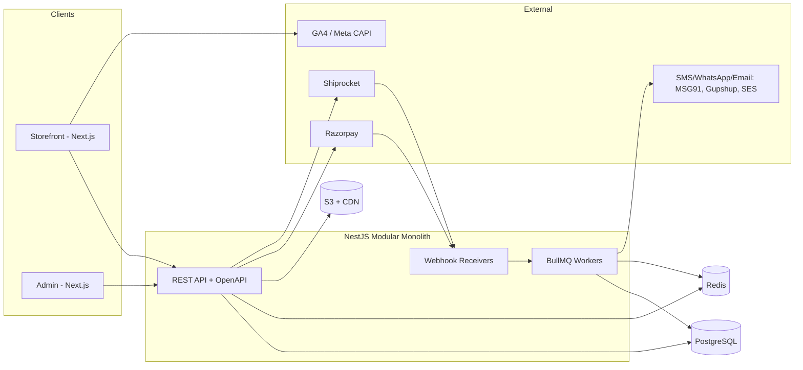
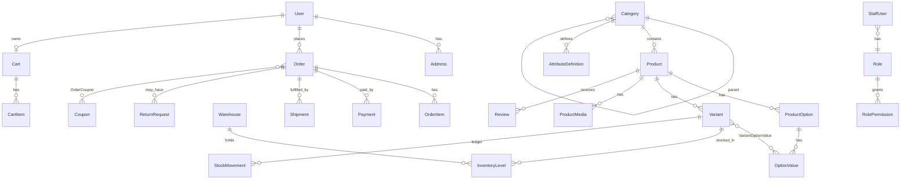

# Milton-Style D2C Commerce Platform: Complete Plan (v2)

> Supersedes the frontend-only [MILTON_ECOMMERCE_PLAN.md](./MILTON_ECOMMERCE_PLAN.md) (kept for its screenshot/UX evidence, sections 1–2 and 5–6 still valid).
> Scope: storefront, admin panel, backend API, database, integrations, security, delivery plan.

---

## 0. Review of the v1 Plan (what was wrong / missing)

| # | Finding | Severity | Fix in v2 |
|---|---|---|---|
| 1 | **No backend, admin, auth, orders, payments, inventory, tax, returns**. Plan is a storefront mock only. | Critical | Sections 4–9 |
| 2 | Money typed as `number` (floats). `₹802.00` style values cause rounding drift in discounts/GST. | Critical | Integer **paise** (`BigInt`/`Int`) everywhere |
| 3 | `specifications` hard-codes bottle fields (`thermalRetention`, `leakProof`) → contradicts the "zero-rewrite new category" goal. | High | Category-defined **attribute schema** + JSONB values (§5) |
| 4 | Variants reference options by *string name*; renaming "Capacity" breaks every variant. | High | Relational `OptionType` / `OptionValue` + join table |
| 5 | Cart is Zustand-only (client). Prices/stock/coupons trusted from client; no guest→user merge; no abandoned-cart. | Critical | Server-authoritative cart; client store is a cache only |
| 6 | Milestone tiers inconsistent: observed ₹699/1,499/1,999/2,999; spec uses 3 tiers 699/1,499/2,999. | Medium | Tiers are **admin data** (`CartMilestone`), not code |
| 7 | "Next.js **or** Vite" left undecided. SSR/SEO needs are explicit, so Vite is wrong. | Medium | Decision: **Next.js (App Router)** |
| 8 | No inventory reservation → oversell during checkout; no payment webhook idempotency. | Critical | Reservation + idempotent webhooks (§7) |
| 9 | No India compliance: GST (HSN, CGST/SGST/IGST, invoices), Legal Metrology labelling, DPDP Act 2023 consent, Consumer Protection (E-Commerce) Rules 2020 (grievance officer, return policy display). | High | §10 |
| 10 | Copies Milton's crimson, wordmark, name "Milton" and mentions "Milton signature". Using their trademark/brand assets is a legal risk. | High | Use a **placeholder brand** (`BRAND_NAME` config + own logo); keep palette *inspiration* only |
| 11 | No SEO plan (structured data, sitemaps, canonical on filtered URLs), no analytics event spec, no testing strategy, no observability, no CI/CD. | Medium | §11–13 |
| 12 | Pincode check "against Indian postal DB" is vague. | Medium | Own `ServiceablePincode` table seeded from courier API, cached (§7.5) |
| 13 | Mixed Tailwind/CSS Modules choice; "no UI kit" but accessibility not specified. | Low | Tailwind + Radix primitives (headless, a11y), WCAG 2.2 AA |
| 14 | Acceptance test "880 ml/Black = ₹998" is hard-coded to mock data. | Low | Tests derive from fixtures |

---

## 1. Product Scope

**Phase A (MVP, launch):** Bottles & Flasks catalog, PDP with variants, cart, guest + OTP checkout, Razorpay (UPI/cards/netbanking) + COD, order tracking, admin (catalog, inventory, orders, coupons, content), email/SMS/WhatsApp transactional notifications.

**Phase B:** Reviews with moderation, wishlist, personalization (engraving), bulk/corporate enquiry, gift milestones, abandoned-cart recovery, returns portal, spare parts cross-sell.

**Phase C:** Additional categories (Tiffins, Casseroles, Cookware, Storage), loyalty/VIP rewards, multi-warehouse, marketplace feeds (Google Merchant, Meta catalog), A/B testing.

**Explicit non-goals (v1):** multi-vendor marketplace, multi-currency, native mobile apps (PWA instead), international shipping.

---

## 2. Architecture Decision Records (summary)

| Decision | Choice | Why | Rejected |
|---|---|---|---|
| Repo | **pnpm + Turborepo monorepo** | Shared types/validators between apps | Polyrepo (type drift) |
| Storefront | **Next.js 15 App Router**, RSC + ISR | SEO, speed, image optimisation | Vite SPA (no SSR), Shopify theme (what we're replacing) |
| Admin | **Separate Next.js app** (`apps/admin`) on admin subdomain | Independent deploy, stricter auth, no admin JS in storefront bundle | Embedded `/admin` route |
| API | **NestJS (TypeScript) modular monolith**, REST + OpenAPI | Structure for a team, guards/DI, queue workers; monolith first | Microservices (premature); Next route handlers only (poor for webhooks/jobs/long-running) |
| DB | **PostgreSQL 16** + Prisma | Relational integrity for orders/inventory; JSONB for attributes; FTS | MongoDB (weak transactions for stock) |
| Cache/Queue | **Redis** + BullMQ | Cart cache, rate limits, reservations TTL, jobs | SQS (later, if needed) |
| Search | Phase A: Postgres FTS + `pg_trgm`. Phase C: Meilisearch/Typesense | Avoid extra infra at <5k SKUs | Elasticsearch (heavy) |
| Media | S3-compatible bucket + CDN, Next/Image or imgproxy → WebP/AVIF | Cost, control | Cloudinary (OK alt) |
| Payments | **Razorpay** (primary), COD via own flow | Best UPI/India coverage, webhooks, refunds API | Gokwik (Milton's own; vendor lock) |
| Shipping | **Shiprocket** aggregator (Delhivery/Bluedart behind it) | One integration, many couriers, rate + pincode + tracking webhooks | Direct courier APIs per carrier |
| Auth (customers) | **Phone OTP** (primary) + email magic link; JWT access (15m) + rotating refresh in httpOnly cookie | India mobile-first | Password-only |
| Auth (admin) | Email + password + **TOTP 2FA**, RBAC, session in httpOnly cookie, IP allowlist optional | Higher privilege | Shared customer auth |
| Hosting | Storefront+Admin on Vercel (or Cloudflare); API+workers on AWS ECS/Fly/Render (Mumbai region); managed Postgres (RDS/Neon) + Redis | Latency to Indian users, simple ops | K8s (overkill) |
| Observability | Sentry, OpenTelemetry → Grafana/Datadog, structured logs (pino) | | |



**Backend modules:** `auth`, `users`, `catalog` (categories, products, variants, attributes), `media`, `inventory`, `pricing` (discount/coupon/milestone engine), `cart`, `checkout`, `orders`, `payments`, `shipping`, `returns`, `reviews`, `cms`, `notifications`, `search`, `analytics`, `admin` (RBAC, audit), `settings`.

---

## 3. Storefront (apps/storefront)

### 3.1 Route map

| Route | Rendering | Notes |
|---|---|---|
| `/` | ISR 5 min | Hero, category circles, featured collections (CMS-driven) |
| `/c/[...categoryPath]` | ISR + on-demand revalidate; filters via `searchParams` (dynamic) | Canonical = unfiltered URL; filtered URLs `noindex,follow` except curated landing pages |
| `/p/[slug]` | ISR + on-demand revalidate on admin save | `Product` + `BreadcrumbList` + `AggregateRating` JSON-LD |
| `/search?q=` | Dynamic | `noindex` |
| `/cart` (also drawer) | Client + server cart | |
| `/checkout` | Dynamic, auth-optional | 3 steps on one page: Contact → Address → Payment |
| `/order/[publicId]/thank-you`, `/track` | Dynamic | Track by order# + phone OTP |
| `/account/*` | Dynamic, authed | Orders, addresses, wishlist, returns, profile/consents |
| `/pages/[slug]` | ISR | CMS pages: shipping, returns, warranty, contact, grievance officer, T&C, privacy |
| `/bulk-enquiry`, `/gifting` | ISR + form | |
| `sitemap.xml`, `robots.txt`, `feeds/google.xml` | Generated | |

### 3.2 State rules (fixes v1 §7)
- **Server state:** TanStack Query (catalog, cart, orders). **UI-only state:** Zustand (drawer open, filter panel, variant selection draft).
- **Cart:** server is source of truth (`Cart` row keyed by cookie `cart_id` for guests, `user_id` after login; merge on login). Client optimistic updates; every response returns fully priced cart (`CartView`) so UI never computes money itself.
- **Variant resolution** is client-side from a compact `variantMatrix` payload on the PDP (zero-latency), but **price/stock are re-validated server-side** at add-to-cart and checkout.
- **Filters** live in URL (`?capacity=500-750&material=ss304`), parsed by a shared Zod schema; facet counts come from the API.

### 3.3 Component inventory (design system `packages/ui`)
Primitives (Radix + Tailwind tokens): Button, Badge, Stepper, Accordion, Dialog/Drawer, Sheet, Tabs, Tooltip, Toast, Skeleton, Input, OTPInput, Select, Checkbox, RangeSlider.
Commerce: ProductCard (swatch-aware), SwatchGroup, PillGroup, PriceBlock, RatingStars, ImageGallery (zoom + swipe), PincodeChecker, MilestoneBar, CouponBox, CartLine, TrustRibbon, StickyBuyBar, AnnouncementTicker, MegaMenu, PredictiveSearch, AddressForm (pincode autofill city/state), PaymentMethodPicker.

### 3.4 Design system
Keep v1 tokens as the *theme file* (`packages/ui/tokens.css`), but rebrand-able via CSS variables. **Fix:** `--color-text-muted #6a7e86` on white = 4.1:1 → darken to `#56696f` (≥4.5:1). Crimson `#c4301c` on white passes (5.5:1); `#d1493f` does not for small text, so use only for large text/graphics. Min tap target 44px. Respect `prefers-reduced-motion`. Fonts self-hosted via `next/font` (`font-display: swap`, size-adjust to keep CLS≈0).

### 3.5 Performance budgets
LCP < 2.5 s on mid-range Android over 4G; INP < 200 ms; CLS < 0.1; JS per route < 170 KB gz; PDP hero image preloaded with explicit width/height; lighthouse-CI gate in PR.

### 3.6 Analytics events (GA4 + Meta CAPI server-side, deduped by `event_id`)
`view_item_list`, `select_item`, `view_item`, `add_to_cart`, `remove_from_cart`, `view_cart`, `begin_checkout`, `add_shipping_info`, `add_payment_info`, `purchase` (fired **server-side from the paid webhook**, not the thank-you page), `search`, `pincode_check`, `coupon_apply`. Consent-gated (DPDP).

---

## 4. Admin Panel (apps/admin)

### 4.1 RBAC

| Role | Access |
|---|---|
| **Owner** | Everything incl. staff, settings, payment/shipping keys, refunds > limit |
| **Catalog Manager** | Categories, attributes, products, variants, media, SEO |
| **Inventory Manager** | Stock levels, adjustments, warehouses, low-stock alerts |
| **Order Manager** | View/edit orders, fulfilment, shipments, cancellations, refunds ≤ configured limit |
| **Support Agent** | Read orders/customers (PII masked by default; reveal logged), returns, reviews moderation |
| **Marketing** | Coupons, milestones, banners, announcement bar, CMS pages, bulk-enquiry leads |
| **Analyst** | Read-only dashboards/exports (no PII) |

Permissions are `resource:action` strings (`product:write`, `order:refund`); roles are rows, not code, so custom roles are possible. Every mutation writes `AuditLog` (actor, entity, before/after diff, IP, UA).

### 4.2 Screens

| Area | Screens & key features |
|---|---|
| **Dashboard** | Today/7d/30d: revenue, orders, AOV, conversion, COD share, RTO %, low-stock, pending shipments, failed payments; top products |
| **Catalog** | Category tree editor (drag-drop); **Attribute definition builder** per category (type: text/number/enum/boolean, unit, filterable?, show in specs?); Product editor (tabs: General · Options & Variants · Media · Specs · SEO · Related/Spare parts); variant matrix generator (select option values → generate SKUs, bulk edit price/stock/barcode in grid); bulk CSV import/export with dry-run validation report; draft/scheduled publish; duplicate product |
| **Media** | Upload (direct-to-S3 presigned), auto-resize, alt-text required, assign image → option value (colour) |
| **Inventory** | Per-variant per-warehouse stock, reserved vs on-hand, adjustment with reason, movement ledger, low-stock threshold, CSV update |
| **Orders** | Filter/search (status, payment, date, pincode, courier); detail with timeline; actions: confirm COD (OTP/IVR status), edit address (pre-ship), create shipment (Shiprocket) + print label/invoice, cancel, refund (full/partial), add internal note, resend notifications |
| **Returns/RMA** | Request queue, approve/reject, schedule reverse pickup, QC outcome, refund/exchange, restock decision |
| **Customers** | List, order history, addresses, consent log, block flag; DPDP actions: export / erase request handling |
| **Marketing** | Coupons (type %, flat, free-ship; min cart, usage caps, per-user cap, product/category scope, stackable?, schedule, auto-apply); **Cart milestones** (threshold → free shipping / gift product / coin); banners & hero slider; announcement ticker; upsell rules (per product/category); abandoned-cart settings |
| **Reviews** | Moderation queue, verified-purchase badge, reply, hide |
| **CMS** | Pages (rich text blocks), FAQ, homepage sections order, SEO meta/redirects manager |
| **Leads** | Bulk/corporate enquiries with status pipeline |
| **Settings** | Store info, GST/GSTIN, shipping rules (free-ship threshold, COD fee/limit, serviceable pincodes), payment toggles, notification templates, staff & roles, API keys (write-only display), webhooks health |
| **Reports** | Sales by product/category/day, GST report (GSTR-1 export), COD vs prepaid, coupon performance, inventory valuation, RTO; CSV export (async job) |
| **Audit log** | Searchable, immutable |

### 4.3 Admin security
Separate origin; TOTP mandatory for all staff; 8h session, re-auth for refunds/role changes/key views; rate-limited login with lockout; CSRF tokens; strict CSP; PII masking; export actions logged; no admin routes in public sitemap; WAF rule restricting `/auth/admin/*` brute force.

---

## 5. Database Design (PostgreSQL via Prisma)

### 5.1 Principles
- IDs: `cuid2`/UUIDv7 internal; **human-friendly `orderNumber`** (sequence, e.g. `ML-100245`) and unguessable `publicId` for guest order URLs.
- **Money = integer paise** (`Int`/`BigInt`). Currency fixed `INR` (column kept for future).
- Order lines **snapshot** title, SKU, price, tax, image at purchase; never join live catalog for historical orders.
- Soft delete (`deletedAt`) for catalog/customers; orders never deleted.
- `createdAt/updatedAt` everywhere; optimistic concurrency via `version` on `InventoryLevel`.
- Category-driven attributes: `AttributeDefinition` per category, values stored in `Product.attributes JSONB` validated against definitions in the service layer, indexed with GIN for filtering.

### 5.2 ER overview



### 5.3 Prisma schema (validated)

The authoritative, `prisma validate`-checked schema lives in [packages/db/schema.prisma](./packages/db/schema.prisma) (≈45 models). Raw-SQL constraints, GIN/trigram indexes, the order sequence and the search trigger are in the `*_constraints_indexes` migration in [packages/db/migrations/](./packages/db/migrations/). Details of intent per group of models:

- **Identity:** `User`, `Address`, `ConsentLog`, `OtpChallenge`, `Session` · **Staff:** `StaffUser`, `Role`, `RolePermission`, `AuditLog`
- **Catalog:** `Category`, `AttributeDefinition`, `Brand`, `Product`, `ProductOption`, `OptionValue`, `Variant`, `VariantOptionValue`, `ProductMedia`, `ProductRelation`
- **Inventory:** `Warehouse`, `InventoryLevel`, `StockMovement`, `StockReservation`, `StockAlertSubscription`
- **Promotions/Cart:** `Coupon`, `CouponRedemption`, `CartMilestone`, `Cart`, `CartItem`
- **Orders/Payments:** `Order`, `OrderItem` (snapshot), `OrderEvent`, `Payment`, `Refund`, `WebhookEvent`
- **Fulfilment:** `Shipment`, `ShipmentEvent`, `ServiceablePincode`, `ReturnRequest`
- **Engagement/Content:** `Review`, `WishlistItem`, `Page`, `Banner`, `Redirect`, `BulkEnquiry`, `Setting`

### 5.4 Required raw-SQL migrations (Prisma can't express; implemented in the SQL file above)
- `CHECK (on_hand >= 0 AND reserved >= 0 AND reserved <= on_hand)` on `InventoryLevel`.
- GIN indexes on `Product.attributes` and `searchVector`; trigger to refresh `searchVector` from title + tagline + category + attributes; `pg_trgm` index on `Product.title` for typo-tolerant suggest.
- Order-number sequence: `CREATE SEQUENCE order_seq START 100001`.
- Partial unique index: one default address per user.
- Row-level: revoke UPDATE/DELETE on `AuditLog`, `StockMovement` for the app role.

### 5.5 Sample: how a new category works with zero code change
Admin creates category `Cookware` → adds `AttributeDefinition`s (`material` ENUM, `induction_compatible` BOOLEAN filterable) → creates product with options `Diameter`, `Lid` → storefront filter sidebar and spec accordion are rendered **from the definitions**; no deploy.

### 5.6 Seed data
12+ bottles from v1 §8 Phase 2 (Felice 12 SKUs, Sparkle 8, Copper, Sports Sipper, Kids Flask), 3 warehouses stub, 4 milestones (699/1,499/1,999/2,999), coupons (`UPI3`, `DIWALI15`), roles + permissions, one owner staff account (password from env, forced reset).

---

## 6. Backend API Design

REST under `/v1`, OpenAPI generated, Zod/class-validator DTOs shared to the frontend via `packages/contracts`. Cursor pagination, `ETag` on catalog reads, RFC 7807 errors, `Idempotency-Key` header on all order/payment POSTs.

### 6.1 Public/customer endpoints

| Area | Endpoints |
|---|---|
| Auth | `POST /auth/otp/request` · `POST /auth/otp/verify` · `POST /auth/refresh` · `POST /auth/logout` · `GET /me` · `PATCH /me` |
| Catalog | `GET /categories/tree` · `GET /categories/{path}/products?filters&sort&cursor` (returns facets+counts) · `GET /products/{slug}` (includes `variantMatrix`) · `GET /products/{slug}/related` · `GET /search?q` · `GET /search/suggest?q` |
| Delivery | `GET /pincode/{pin}` → `{serviceable, codAllowed, etaMin, etaMax, estimatedDate}` |
| Cart | `GET /cart` · `POST /cart/items` · `PATCH /cart/items/{id}` · `DELETE /cart/items/{id}` · `POST /cart/coupon` · `DELETE /cart/coupon` · `POST /cart/merge` (on login) · all return priced `CartView` incl. milestone progress |
| Checkout | `POST /checkout/session` (validates, reserves stock 15 min) · `POST /checkout/orders` (creates order + Razorpay order or COD) · `POST /checkout/cod/verify` |
| Payments | `POST /payments/verify` (client signature check, non-authoritative) · **`POST /webhooks/razorpay`** (authoritative) |
| Orders | `GET /orders` · `GET /orders/{publicId}` · `POST /orders/track` (order# + phone OTP) · `POST /orders/{id}/cancel` · `GET /orders/{id}/invoice.pdf` |
| Returns | `POST /returns` · `GET /returns` |
| Engagement | `POST /reviews` · `GET /products/{id}/reviews` · `POST|DELETE /wishlist/{productId}` · `POST /stock-alerts` · `POST /enquiries/bulk` |
| CMS | `GET /pages/{slug}` · `GET /home` (sections/banners/announcements) |
| Webhooks | `POST /webhooks/shiprocket` |

### 6.2 Admin endpoints (`/admin/v1`, RBAC-guarded, audit-logged)
CRUD: `categories`, `attributes`, `products`, `variants` (+ `POST /products/{id}/variants/generate`), `media` (`POST /media/presign`), `warehouses`, `inventory` (`POST /inventory/adjust`), `coupons`, `milestones`, `banners`, `pages`, `redirects`, `staff`, `roles`.
Orders: `GET /orders`, `GET /orders/{id}`, `POST /orders/{id}/confirm|cancel|refund|shipments|notes`, `POST /shipments/{id}/label`.
Ops: `GET /reports/{type}` (async export job), `POST /imports/products` (dry-run + commit), `GET /audit-logs`, `GET /webhooks/events` (+ replay).

### 6.3 Critical business logic

**Pricing engine** (pure function, unit-tested heavily, single source of truth):
`items → line subtotal → coupon(s) discount allocation (pro-rata per line) → payment-method offer (UPI 3%) → shipping (free ≥ threshold, else pincode/weight slab) → COD fee → milestone rewards → GST breakdown (inclusive: tax = price × rate/(100+rate)) → total`. Rounding: compute per line in paise, allocate remainder to the largest line so totals reconcile exactly.

**Inventory reservation:** checkout session → `SELECT … FOR UPDATE` on `InventoryLevel` rows (ordered by id to avoid deadlocks) → `reserved += qty` + `StockReservation(expiresAt = now+15m)`. Payment captured → `onHand -= qty, reserved -= qty`, write `StockMovement(SALE)`. Expiry worker releases stale holds every minute.

**Order state machine:** `PENDING_PAYMENT → PLACED (paid / COD verified) → CONFIRMED → PROCESSING → SHIPPED → DELIVERED → CLOSED`; side branches `CANCELLED`, `RETURNED`. Transitions only via a service guarded by an allowed-transitions table; each writes `OrderEvent`.

**Payment flow (prepaid):**
1. Client submits checkout with `Idempotency-Key` → server re-prices, creates `Order(PENDING_PAYMENT)` + Razorpay order (amount from server).
2. Razorpay Checkout in browser → success handler calls `/payments/verify` (HMAC check) for fast UX only.
3. **Webhook `payment.captured`** (verified signature, dedup via `WebhookEvent(provider,eventId)`) is what flips order → `PLACED`, commits stock, enqueues notifications, fires server-side `purchase` analytics.
4. Reconciliation cron every 10 min: fetch Razorpay payments for `PENDING_PAYMENT` orders older than 10 min (covers missed webhooks); auto-cancel + release stock after 30 min.

**COD flow:** order created `PLACED` with `COD_PENDING`; OTP/WhatsApp confirm required above ₹X or for risky pincodes (RTO score); unconfirmed in 24h → auto-cancel. Max COD value and per-pincode eligibility are admin settings.

**Shipping:** on `CONFIRMED`, worker creates Shiprocket order, saves AWB/label, subscribes to tracking webhook → updates `Shipment`/`Order` status and notifies the customer.

**Notifications (queue-driven, templated, retries with backoff):** OTP, order placed, payment failed, shipped (with tracking link), out for delivery, delivered, COD confirm, refund processed, back-in-stock, abandoned cart (1h/24h, consent-gated). Channels: SMS (MSG91, DLT-registered templates), WhatsApp (Gupshup/Meta Cloud API), email (SES).

**Abandoned cart:** cart with phone/email captured at checkout step 1 and no order in 60 min → job → templated message with a signed cart-restore link.

### 6.4 Cross-cutting
- **Validation** at every boundary; whitelist DTO fields (no mass assignment).
- **Rate limits (Redis):** OTP 3/10 min per phone + per IP; login; pincode check; coupon apply (anti-guessing); search.
- **Caching:** catalog reads via Redis (tag-invalidated on admin write) + Next ISR revalidation webhook to storefront.
- **Transactions:** order creation, stock, payment-capture handlers in single DB transactions; outbox table pattern (or BullMQ enqueue after commit) to avoid lost notifications.
- **Errors/logging:** correlation id per request, PII redaction in logs.

---

## 7. Security & Privacy

| Risk | Control |
|---|---|
| Price/stock tampering | Server re-prices everything; client sends only `variantId`, `qty`, `couponCode` |
| Payment fraud / replay | HMAC verify, webhook dedup, amount matched to order, idempotency keys |
| OTP abuse / SMS pumping | Per-phone/IP limits, captcha (Turnstile) after threshold, DLT templates, daily SMS budget alarm |
| Account takeover | Short JWT + rotating refresh tokens (reuse detection), httpOnly+SameSite=Lax cookies, device list |
| XSS | React escaping; `descriptionHtml` sanitised server-side (allow-list) on save; strict CSP w/ nonces |
| CSRF | SameSite + CSRF token on cookie-auth mutations |
| IDOR | Order access by owner or `publicId`+OTP; every query scoped by user |
| SQLi | Prisma parameterised; raw SQL only in reviewed migrations |
| Secrets | Env via secret manager; Razorpay/Shiprocket keys never to the client; TOTP secrets encrypted (AES-GCM, KMS key) |
| Bot scraping / carting | Rate limit + WAF (Cloudflare), reservation only at checkout, not add-to-cart |
| PII | Encrypted at rest (DB + backups), TLS everywhere, masked in admin, retention policy, export/erase flow (DPDP) |
| PCI | Card data never touches our servers (Razorpay hosted checkout, SAQ-A) |
| Supply chain | Lockfile, Renovate/Dependabot, `pnpm audit` + CodeQL in CI |

---

## 8. India Compliance Checklist

- **GST:** HSN per product, rate per product (most steel drinkware 18%; verify with CA), CGST+SGST (intra-state) vs IGST (inter-state) from warehouse state vs ship-to state; tax-invoice PDF with GSTIN, invoice number series, place of supply; credit notes for refunds; GSTR-1 export.
- **Legal Metrology (Packaged Commodities) Rules:** show MRP (incl. taxes), net quantity, manufacturer/importer name & address, country of origin, customer-care contact on PDP.
- **Consumer Protection (E-Commerce) Rules 2020:** grievance officer name/contact, seller details, return/refund/warranty terms on site, no dark patterns, display total price incl. all charges before payment.
- **DPDP Act 2023:** explicit consent (separate for marketing), purpose-limited collection, privacy notice, data-principal rights (access/erase) workflow, breach process.
- **TRAI DLT:** registered headers/templates for SMS; WhatsApp opt-in.
- **Trademark/brand:** use own brand name, logo and imagery; reference-site assets and the "Milton" name are not to be reused. (If this *is* for Milton Group, obtain written authorisation and asset licences.)

---

## 9. Quality, DevOps & Observability

**Testing pyramid**
- Unit (Vitest/Jest): pricing engine (property tests: sum of lines == total, no negative totals), variant resolver, state machine, coupon rules, GST split.
- Integration (Testcontainers Postgres+Redis): reservation concurrency (100 parallel buyers of last unit → exactly 1 wins), webhook idempotency, order creation, RBAC guards.
- Contract: OpenAPI schema diff in CI to catch breaking changes.
- E2E (Playwright): browse → filter → PDP variant → cart milestone → checkout (Razorpay test mode) → order visible in admin → ship → track. Mobile viewport matrix.
- Non-functional: k6 load test (500 rps catalog, 50 checkouts/s), axe-core a11y in CI, Lighthouse-CI budgets.

**CI/CD:** GitHub Actions: lint → typecheck → unit → integration → build → e2e (on PR preview) → deploy. Prisma migrations run as a gated step (expand/contract, no destructive change in the same release). Preview env per PR. Feature flags (Unleash/PostHog) for risky features.

**Environments:** `local` (docker-compose: pg, redis, minio, mailpit) → `staging` (Razorpay/Shiprocket sandbox) → `prod`. Daily DB backups + PITR, restore drill quarterly. Seed script only for non-prod.

**Observability & alerts:** Sentry (FE+BE), uptime checks, p95 latency, payment-success-rate, webhook failure count, queue depth/age, low-stock, 5xx rate, OTP send failures. Runbooks for payment mismatch, webhook outage, stock drift.

---

## 10. Delivery Roadmap (sizing for 2–3 engineers + 1 designer)

| Phase | Weeks | Deliverables | Exit criteria |
|---|---|---|---|
| **0 Foundations** | 1 | Monorepo, CI, envs, design tokens, UI primitives, Prisma base, auth skeleton | CI green, preview deploys work |
| **1 Catalog core** | 2–3 | Schema + migrations, category/attribute/product/variant services, admin catalog screens, media upload, seed, CSV import | Admin can create a 12-SKU product end-to-end |
| **2 Storefront browse** | 3–5 | Header/mega-menu, collection page w/ facets (URL-driven), PDP w/ variant matrix, gallery, SEO/JSON-LD, search | Lighthouse budgets met; variant switching zero-reload |
| **3 Cart & pricing** | 5–6 | Server cart, pricing engine, coupons, milestones, drawer UI, upsells, pincode checker | Pricing property tests pass; milestone acceptance tests |
| **4 Checkout & payments** | 6–8 | OTP auth, address, Razorpay, COD, reservations, webhooks, reconciliation, invoices, notifications | Concurrency + webhook-replay tests pass; sandbox E2E green |
| **5 Fulfilment & orders admin** | 8–9 | Order screens, Shiprocket, tracking page, cancel/refund, returns v1 | Full order lifecycle in staging |
| **6 Hardening & launch** | 9–10 | Security review, load test, a11y pass, compliance pages, analytics QA, backup drill, soft launch | Go-live checklist signed off |
| **7 Post-launch** | 11+ | Reviews, wishlist, personalization, abandoned-cart, bulk enquiry, additional categories | Metrics-driven |

**Repo layout**
```
apps/storefront   apps/admin   apps/api
packages/ui       packages/contracts (zod + openapi types)   packages/config (eslint/ts/tailwind)
packages/db (prisma schema, migrations, seed)   infra/ (docker-compose, IaC)   docs/
```

---

## 11. Acceptance Criteria (replaces v1 §9; all fixture-driven)

| Subsystem | Test | Expected |
|---|---|---|
| Variant switching | Select any in-stock combo | Price/MRP/discount/SKU/gallery update with no navigation; server re-validates on add-to-cart |
| Out of stock | Select OOS combo | CTA → "Notify Me", add-to-cart blocked client **and** server |
| Last-unit race | 100 concurrent checkouts for 1 unit | Exactly 1 order succeeds; others get a clean "just sold out" error; `reserved` never exceeds `onHand` |
| Pricing integrity | Randomised carts + coupons | `Σ lines == total`; no negative; GST split reconciles to the paisa |
| Milestones | Subtotal crosses each admin-defined threshold | Bar, copy and reward line items update; removing items revokes gift |
| Filters | Multi-select facets | Grid + counts + URL update; direct URL load renders identical SSR result; filtered URL is `noindex` |
| Payments | Webhook delivered twice / out of order / never | Single order transition; missed webhook recovered by reconciliation ≤ 10 min |
| COD | Ineligible pincode / over limit | COD option hidden; server rejects forced submission |
| New category | Create `Cookware` + `Diameter` in admin only | Renders in storefront filters/PDP with no code change |
| Security | Tamper price/qty in request; access another user's order | Rejected (400/403); covered by automated tests |
| Admin RBAC | Support Agent hits `product:write` | 403 + audit entry |
| Performance | Mid-range Android, 4G | LCP < 2.5 s, CLS < 0.1, INP < 200 ms on PDP & collection |
| Accessibility | axe + keyboard walkthrough | No critical violations; focus trapped in drawer; swatches have text labels |
| Compliance | Place order | Invoice has GSTIN/HSN/place-of-supply; PDP shows MRP, origin, manufacturer, grievance contact |

---

> Defaults for all of these, plus wireframes, API examples, a worked pricing test, the backlog (~141 person-days), risk register, cost estimate and launch checklist, are in [MILTON_ECOMMERCE_PLAN_V2_APPENDIX.md](./MILTON_ECOMMERCE_PLAN_V2_APPENDIX.md).

## 12. Open Questions (defaults assumed in the appendix; confirm before Phase 1)

1. Is this a clone for learning/portfolio, or a real store? (Drives §8 branding/legal and whether real GST/Razorpay live keys are needed.)
2. Single warehouse or multi? (Schema supports multi; Phase A UI can hide it.)
3. COD policy: allowed? limits? fee? (Largest RTO cost driver.)
4. Team size / timeline (roadmap assumes 2–3 engineers, ~10 weeks to launch).
5. Self-host vs managed cloud and monthly infra budget.
6. Need for Hindi/regional language at launch? (Add `next-intl` + translation tables now if yes.)
